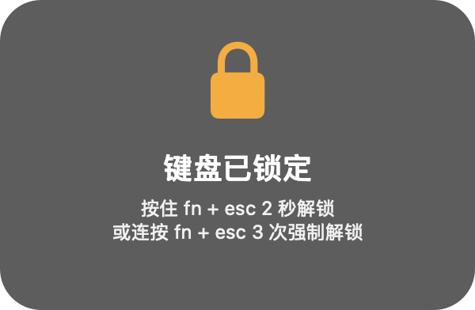
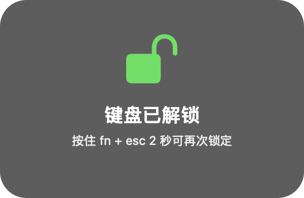

# 键盘锁 KeyLock

一个 macOS 菜单栏小工具：**按住 fn 再长按 esc 2 秒，锁住整个键盘**；再按一次解锁。

适合把 iPad、书本或者猫放在 MacBook 键盘上的时候用——键盘被压到也不会乱输入。

<p>
  
  
  
</p>

> 截图为离屏渲染的示意图，实际浮层是毛玻璃背景。

## 功能

| 操作 | 效果 |
|---|---|
| 按住 `fn`，再长按 `esc` 2 秒 | 锁定键盘 |
| 锁定后再次 `fn + esc` 长按 2 秒 | 解锁 |
| 1.5 秒内连按 `fn + esc` 3 次 | 强制解锁（防止卡死的保险） |
| 点击菜单栏图标 | 用鼠标锁定 / 解锁、开关提示音、开机自启、退出 |

锁定时，除了 `fn + esc` 以外的所有按键（包括修饰键、亮度 / 音量等媒体键）都会被拦截，不会到达任何应用。

界面提示：

- **长按过程中**：屏幕中央出现带进度条的浮层，松开即取消。
- **锁定 / 解锁成功**：浮层显示橙色锁 / 绿色开锁图标，并播放提示音。
- **锁定期间**：屏幕顶部常驻一个小胶囊提醒，菜单栏图标变成橙色的锁。

## 安装

需要 macOS 13 及以上，以及 Xcode 命令行工具（`xcode-select --install`）。

```bash
./build.sh
```

脚本会在当前目录生成 `键盘锁.app`。把它拖到「应用程序」文件夹后双击打开即可。

### 首次授权

第一次打开时，系统会提示授予 **辅助功能** 权限（拦截键盘事件必须要这个权限）：

**系统设置 → 隐私与安全性 → 辅助功能 → 打开「键盘锁」的开关**

授权后一两秒内屏幕中央会出现「键盘锁已就绪」，无需重启应用。

> 应用使用本地 ad-hoc 签名。每次重新编译后，系统会把它当成一个新程序，需要重新勾选一次辅助功能权限。

## 已知限制

- **Caps Lock 指示灯、Touch ID / 电源键**：在更底层处理，拦截不到。
- **密码输入框、登录 / 锁屏界面**：macOS 的安全输入会屏蔽所有键盘事件拦截，此时锁定不生效，`fn + esc` 也检测不到。
- **触控板不会被锁**：压到触控板仍会触发点击。
- **fn（地球仪）键自带的功能**：如果把 fn 设成了切换输入法或表情面板，按 `fn + esc` 时可能顺带触发。
- 需要键盘上有能被系统识别的 `fn` 键（MacBook 内置键盘、Apple 妙控键盘）。

## 工作原理

用 `CGEventTap` 在会话层挂一个事件拦截器，监听 `keyDown` / `keyUp` / `flagsChanged` 以及媒体键对应的系统定义事件：

- `fn + esc` 的按下永远被吞掉（不会把 esc 漏给前台应用），并启动一个 2 秒计时器；`esc` 或 `fn` 任意一个提前松开就取消。
- 计时器到点切换锁定状态；锁定时回调对其余键盘事件一律返回 `nil`。
- 连按计数用一个 1.5 秒的滑动时间窗。
- 一个 1.5 秒周期的看门狗负责：等待授权、权限被撤销时立刻撤掉拦截器、拦截器被系统停用时重新启用。
- 应用退出或崩溃时拦截器随进程消失，键盘自动恢复。

## 项目结构

```
Sources/main.swift    应用主体：事件拦截、fn+esc 状态机、菜单栏
Sources/UI.swift      提示浮层、进度条、顶部胶囊
Sources/Debug.swift   自测与界面快照入口
make_icon.swift       生成应用图标
build.sh              编译、打包、签名
DEVLOG.md             开发记录
LICENSE               MIT 许可证
```

可调参数（长按时长、连按时间窗等）在 `Sources/main.swift` 开头。

## 调试

```bash
# 用合成按键事件验证锁定 / 解锁逻辑，不需要任何权限
./键盘锁.app/Contents/MacOS/KeyLock --selftest

# 把各状态的提示浮层渲染成 PNG
./键盘锁.app/Contents/MacOS/KeyLock --snapshot ./snapshots
```

开发过程与设计取舍见 [DEVLOG.md](DEVLOG.md)。

## 许可证

[MIT](LICENSE)
